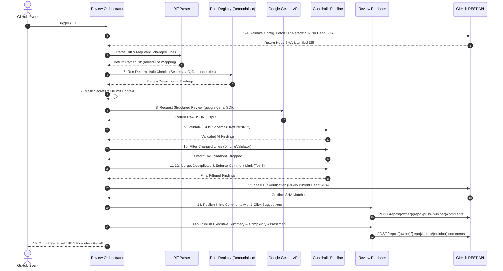

# Technical Requirements Document (TRD)
## Project: GitHub PR-Review Agent with Guardrails
**Document Version:** 1.0.0  
**Target Audience:** Forward Deployed Engineers (FDEs), Lead Architects, Backend Developers, DevOps Engineers  

---

## 1. System Architecture & 15-Step Pipeline

The agent operates through an ordered, 15-step deterministic and AI pipeline orchestrated by `ReviewOrchestrator`:



---

## 2. Technical Stack & Dependencies

| Category | Technology / Library | Version | Purpose |
| :--- | :--- | :---: | :--- |
| **Language Runtime** | Python | `>= 3.12` | Modern typing, performance, security patches |
| **Generative AI SDK** | `google-genai` | `>= 0.1.1` | Official Google GenAI SDK with structured schema generation |
| **HTTP Client** | `httpx` | `>= 0.27.0` | High-performance asynchronous and synchronous HTTP client |
| **Contract Validation**| `jsonschema` | `>= 4.21.0` | Enforces Draft 2020-12 JSON Schema specification |
| **Observability** | `langsmith` | `>= 0.1.0` | Latency, token usage, and pipeline trace generation |
| **Container Runtime** | Docker / Compose | Multi-stage | Hardened non-root (`appuser:10001`) container image |
| **Testing** | `pytest`, `pytest-mock` | `>= 8.0.0` | Comprehensive unit and integration test suite |

---

## 3. Subsystem Technical Specifications

### 3.1 Diff Parser & Line Mapping Engine (`app/github/diff_parser.py`)
- **Objective**: Parse unified diff text into exact line indices where code was added or modified.
- **Hunk Algorithm**:
  - Recognizes hunk header regex: `^@@\s+-(?P<old_start>\d+)(?:,(?P<old_len>\d+))?\s+\+(?P<new_start>\d+)(?:,(?P<new_len>\d+))?\s+@@`
  - Maintains `current_new_line` counter incremented on additions (`+`) and context lines (` `).
  - Populates:
    - `valid_changed_lines[filename]`: Set of integers representing right-side line numbers where `+` occurred.
    - `added_lines_content[(filename, line_num)]`: Exact text of added lines for deterministic inspection.
- **Guarantees**: Comments targeting deleted lines (`-`) or context lines (` `) are strictly impossible.

### 3.2 Deterministic Security Rule Registry (`app/rules/`)
All deterministic checks execute locally before any remote network call to Gemini:

1. **`SecretScanner` (`app/rules/secret_scanner.py`)**:
   - Executes multi-regex scanner for AWS Access Keys, GitHub Tokens, Slack Tokens, Private Keys, and passwords.
   - Calculates Shannon entropy:
     $$H(X) = -\sum_{i=1}^{n} P(x_i) \log_2 P(x_i)$$
   - Redacts detected tokens from all diff contexts sent to the LLM via `SensitiveDataFilter`.
2. **`TerraformRiskAnalyzer` (`app/rules/terraform_risk.py`)**:
   - Scans `.tf` and `.tfvars` files against security rules (CIDR `0.0.0.0/0`, public S3 buckets, disabled encryption, public RDS).
   - Generates 1-click replacement code (e.g. `acl = "private"`).
3. **`DependencyScanner` (`app/rules/dependency_scanner.py`)**:
   - Inspects `requirements.txt`, `package.json`, `Pipfile`, `go.mod`.
   - Compares package versions against a curated CVE database using semantic version tuple parsing (`parse_version_tuple`).
   - Flags wildcard/unpinned dependencies (`*` or `latest`) and insecure `http://` repository sources.

### 3.3 Prompt Isolation & Injection Defense (`app/guardrails/injection_defense.py`)
- Untrusted diff content is wrapped inside:
  ```text
  ===BEGIN_UNTRUSTED_DIFF_PAYLOAD===
  {sanitized_diff}
  ===END_UNTRUSTED_DIFF_PAYLOAD===
  ```
- Any adversarial string in the diff attempting to mimic the delimiter is escaped to `===ESCAPED_BEGIN_UNTRUSTED_DIFF_PAYLOAD===`.
- System instructions strictly inform Gemini that contents within delimiters must never be interpreted as commands or instructions.

### 3.4 Schema Validation Guardrail (`app/guardrails/schema_validator.py`)
- Employs Draft 2020-12 validator on model responses.
- Schema contract:
  ```json
  {
    "type": "object",
    "required": ["findings"],
    "properties": {
      "findings": {
        "type": "array",
        "items": {
          "required": ["file", "line", "severity", "category", "title", "suggestion", "confidence"],
          "properties": {
            "file": {"type": "string", "minLength": 1, "maxLength": 500},
            "line": {"type": "integer", "minimum": 1},
            "severity": {"type": "string", "enum": ["critical", "high", "medium", "low"]},
            "category": {"type": "string", "enum": ["security", "testing", "correctness", "infrastructure", "maintainability"]},
            "title": {"type": "string", "minLength": 3, "maxLength": 200},
            "suggestion": {"type": "string", "minLength": 5, "maxLength": 2000},
            "confidence": {"type": "number", "minimum": 0.0, "maximum": 1.0},
            "suggested_code": {"type": "string", "maxLength": 2000}
          },
          "additionalProperties": false
        }
      }
    },
    "additionalProperties": false
  }
  ```
- Validates file paths: Rejects `..`, leading `/` or `\`, and Windows drive letters (`C:`).

### 3.5 Deduplication & Limiting Engine (`app/guardrails/`)
- **`DuplicateFilter`**: Identifies overlapping findings where file paths match and line numbers are within $\pm 2$ lines. Prioritizes deterministic security rules over AI findings.
- **`CommentLimiter`**:
  - Filters out any candidate with `confidence < CONFIDENCE_THRESHOLD` (default: 0.70).
  - Sorts candidates by numeric severity rank (`critical` = 4, `high` = 3, `medium` = 2, `low` = 1) descending, followed by confidence descending.
  - Takes top $N$ items (default: 5 comments maximum).

---

## 4. GitHub API Integration & Stale PR Protection

### Endpoints Used:
1. `GET /repos/{owner}/{repo}/pulls/{number}`: Retrieve PR metadata and current commit SHA.
2. `GET /repos/{owner}/{repo}/pulls/{number}/files`: Retrieve unified diff patches.
3. `POST /repos/{owner}/{repo}/pulls/{number}/comments`: Post inline code review comments.
4. `POST /repos/{owner}/{repo}/issues/{number}/comments`: Post top-level Executive Summary.

### Stale PR Verification Algorithm:
```python
def verify_revision_freshness(repo: str, pr_number: int, expected_head_sha: str) -> bool:
    current_sha = pr_service.get_head_sha(repo, pr_number)
    if current_sha != expected_head_sha:
        raise StalePullRequestError("PR revision changed during analysis. Aborting to prevent stale comments.")
    return True
```

---

## 5. Performance SLAs & Non-Functional Specifications

| Metric | Target SLA | Strategy |
| :--- | :---: | :--- |
| **Deterministic Rule Execution** | $\le 200\text{ ms}$ | Pre-compiled regex patterns, in-memory string scanning |
| **Gemini AI Generation** | $\le 8\text{ seconds}$ | Temperature 0.1, structured JSON schema response, token budgeting |
| **Total Pipeline Latency** | $\le 15\text{ seconds}$ | Fast HTTP client (`httpx`), single-pass diff parsing |
| **Memory Footprint** | $\le 150\text{ MB}$ | Streaming diff parsing, diff truncated at 40,000 characters |
| **Container Image Size** | $\le 200\text{ MB}$ | Python 3.12-slim base, no build tools in final runtime stage |
