# GitHub PR-Review Agent with Guardrails

[](https://www.python.org/)
[](LICENSE)
[](#security-guardrails)

A modular, security-focused automated first-pass code review agent for GitHub Pull Requests. It combines **deterministic security scanning** (credentials, tokens, risky Terraform configurations) with **Google Gemini AI analysis**, protected by strict **schema validation, changed-line restrictions, comment limits, and prompt-injection defenses**.

---

## Table of Contents

1. [Business Problem & Intended Users](#business-problem--intended-users)
2. [Key Features & Capabilities](#key-features--capabilities)
3. [Architecture & 15-Step Pipeline](#architecture--15-step-pipeline)
4. [Repository Structure](#repository-structure)
5. [Security Model & Guardrails](#security-model--guardrails)
6. [Why the Agent Cannot Merge, Approve, or Push Code](#why-the-agent-cannot-merge-approve-or-push-code)
7. [Environment Variables & Configuration](#environment-variables--configuration)
8. [GitHub Permissions & Setup](#github-permissions--setup)
9. [Gemini API Configuration](#gemini-api-configuration)
10. [LangSmith Observability & Tracing](#langsmith-observability--tracing)
11. [GitHub Actions Workflow](#github-actions-workflow)
12. [Running Tests in an Authorized Environment](#running-tests-in-an-authorized-environment)
13. [Evaluation Framework & Benchmarking](#evaluation-framework--benchmarking)
14. [Limitations & Threat Model](#limitations--threat-model)

---

## Business Problem & Intended Users

### The Problem
Engineering and security teams review dozens of pull requests daily. Manual reviews often struggle with:
- **Accidental Credential Exposure**: API keys, private keys, and passwords committed in code or tests.
- **Insecure Infrastructure as Code (IaC)**: Overly permissive security groups (`0.0.0.0/0`), public S3 buckets, and disabled encryption in Terraform.
- **Subtle Logic Errors & Missing Tests**: Inverted comparison checks, unhandled edge cases, or untested critical logic.
- **Alert Fatigue & Hallucinations**: Generic AI reviewers that post dozens of nitpicks on unchanged lines or attempt to execute adversarial instructions embedded in diff comments.

### Intended Users
- **Senior Software Engineers & Tech Leads**: Accelerates routine code inspection.
- **DevSecOps & Application Security Engineers**: Enforces baseline security policies on every PR before human review.
- **Engineering Managers**: Ensures consistent review standards across growing engineering organizations.

The agent is an **assistant for human reviewers, not an autonomous merge bot**.

---

## Key Features & Capabilities

- **Deterministic Secret Scanner**: Independent Python regex and Shannon entropy scanner detecting AWS keys, GitHub tokens, Slack tokens, private keys, and hardcoded passwords before any code is shared with external APIs.
- **Terraform Risk Analyzer**: Identifies risky IaC patterns such as public ingress (`0.0.0.0/0`), public S3 ACLs, disabled S3 public access blocks, disabled volume encryption, and wildcard IAM policies.
- **Google Gemini Provider**: Uses the official `google-genai` SDK with structured JSON output and low temperature for reproducible code analysis.
- **Zero Comments on Unchanged Lines**: Enforces strict changed-line mapping against unified diff hunks, rejecting comments on unmodified lines or deleted files.
- **Strict Comment Limiting**: Enforces a configurable cap (default: 5 comments) prioritizing high-severity, high-confidence issues.
- **Deduplication Engine**: Merges overlapping findings between deterministic rules and AI suggestions.
- **Stale PR Protection**: Checks current PR commit SHA before publishing; aborts if new commits were pushed during analysis.
- **Prompt Injection Defense**: Encapsulates diffs within unforgeable boundary delimiters, escaping internal delimiter occurrences and sanitizing output.
- **Secret Redaction**: Redacts all detected credentials from prompts, logs, exceptions, and comments.

---

## Architecture & 15-Step Pipeline

The agent operates through an ordered, 15-step deterministic and AI review pipeline:

```mermaid
flowchart LR
    A[1. Validate Config] --> B[2. Validate Repo/PR]
    B --> C[3-4. Fetch PR & Head SHA]
    C --> D[5. Parse Diff Hunks]
    D --> E[6. Deterministic Checks]
    E --> F[7. Redact & Delimit Diff]
    F --> G[8. Gemini Analysis]
    G --> H[9. Schema Validation]
    H --> I[10. Changed-Line Validation]
    I --> J[11. Merge Findings]
    J --> K[12. Deduplicate & Limit]
    K --> L[13. Check PR Freshness]
    L --> M[14. Publish Comments]
    M --> N[15. Log Output Summary]
```



For comprehensive architectural specifications and diagrams, see [docs/architecture.md](file:///d:/GitHub%20PR-review%20agent%20with%20guardrails/docs/architecture.md).

---

## Repository Structure

```text
github-pr-review-agent/
├── .github/
│   └── workflows/
│       └── pr-review.yml          # Least-privilege GitHub Actions workflow
├── app/
│   ├── __init__.py                # Package declaration
│   ├── main.py                    # Application CLI entry point
│   ├── config/
│   │   ├── __init__.py
│   │   └── settings.py            # Environment configuration & log redaction
│   ├── github/
│   │   ├── __init__.py
│   │   ├── client.py              # Lightweight HTTP client with rate limits
│   │   ├── pull_request.py        # PR metadata & patch fetcher
│   │   ├── diff_parser.py         # Unified diff parser & line mapper
│   │   └── review_publisher.py    # Stale-checked inline comment publisher
│   ├── providers/
│   │   ├── __init__.py
│   │   ├── base.py                # Abstract AI provider interface
│   │   └── gemini_provider.py     # Official google-genai integration
│   ├── review/
│   │   ├── __init__.py
│   │   ├── orchestrator.py        # 15-step pipeline coordinator
│   │   ├── prompt_builder.py      # Untrusted diff isolating prompt builder
│   │   ├── finding_merger.py      # Deterministic & AI finding merger
│   │   └── severity.py            # Severity ranking & metrics
│   ├── rules/
│   │   ├── __init__.py
│   │   ├── secret_scanner.py      # Deterministic credential detector
│   │   ├── terraform_risk.py      # Deterministic IaC security analyzer
│   │   └── rule_registry.py       # Rule coordinator
│   ├── guardrails/
│   │   ├── __init__.py
│   │   ├── schema_validator.py    # jsonschema finding contract validator
│   │   ├── diff_line_validator.py # Changed-line restriction guardrail
│   │   ├── comment_limiter.py     # Max comment count & confidence filter
│   │   ├── duplicate_filter.py    # Overlapping finding deduplicator
│   │   └── injection_defense.py   # Boundary delimiters & pattern checks
│   └── schemas/
│       ├── __init__.py
│       └── review_finding.py      # ReviewFinding dataclass & JSON schema
├── tests/
│   ├── fixtures/
│   │   ├── safe_diff.patch        # Clean test patch
│   │   ├── secret_diff.patch      # Synthetic credential test patch
│   │   ├── terraform_risky_diff.patch # Insecure IaC test patch
│   │   └── prompt_injection_diff.patch # Adversarial injection patch
│   ├── test_secret_scanner.py     # Secret scanner & redaction tests
│   ├── test_terraform_risk.py     # Terraform risk rule tests
│   ├── test_schema_validator.py   # Schema validation & safety tests
│   ├── test_diff_line_validator.py# Changed-line guardrail tests
│   ├── test_comment_limiter.py    # Comment limit & priority tests
│   ├── test_injection_defense.py  # Prompt injection defense tests
│   ├── test_github_permissions.py # Least-privilege workflow tests
│   └── test_review_orchestrator.py# Mocked end-to-end pipeline tests
├── evals/
│   ├── datasets/
│   │   └── labelled_prs.json      # Labelled benchmark PR scenarios
│   ├── evaluator.py               # Evaluation benchmark runner
│   ├── metrics.py                 # Precision, Recall, F1, FPR calculations
│   └── README.md                  # Evaluation guide
├── docs/
│   ├── architecture.md            # Detailed architecture documentation
│   ├── security-model.md          # Threat model & security specifications
│   └── evaluation-methodology.md  # Benchmark methodology & metric math
├── .env.example                   # Template configuration
├── .gitignore                     # Git ignore rules
├── pyproject.toml                 # Build configuration & pytest settings
├── requirements.txt               # Pinned dependencies
├── Dockerfile                     # Non-root container runtime artifact
└── README.md                      # This comprehensive guide
```

---

## Security Model & Guardrails

The application enforces security guardrails at every layer:

1. **Deterministic Pre-Checks**: Scanners run *before* any LLM invocation. Secrets are redacted immediately so raw tokens never appear in prompts, logs, or comments.
2. **Untrusted Diff Isolation**: All PR contents are treated as hostile data, wrapped in unforgeable boundaries (`===BEGIN_UNTRUSTED_DIFF_PAYLOAD===`).
3. **No Tool Execution**: The Gemini model is given zero function calling or tool access; it cannot execute shell commands or access network resources.
4. **Schema Strictness**: Responses must conform to [`REVIEW_FINDINGS_JSON_SCHEMA`](file:///d:/GitHub%20PR-review%20agent%20with%20guardrails/app/schemas/review_finding.py). Path traversals (`..`) or invalid categories cause immediate finding rejection.
5. **Diff Line Containment**: Comments can only be posted to line numbers verified by `DiffParser` as additions/modifications in the PR.

For complete threat analysis, see [docs/security-model.md](file:///d:/GitHub%20PR-review%20agent%20with%20guardrails/docs/security-model.md).

---

## Why the Agent Cannot Merge, Approve, or Push Code

To eliminate privilege escalation risks, the agent is architecturally incapable of modifying repository code or altering review state:

- **No Approval Capability**: The agent posts comments using the `COMMENT` event or direct line comment endpoints. It never calls `APPROVE` or changes branch protection status.
- **No Merging Endpoints**: The codebase contains no methods, endpoints, or logic to invoke GitHub's merge APIs (`PUT /repos/{owner}/{repo}/pulls/{number}/merge`).
- **No Code Modification**: The workflow does not request `contents: write`, preventing any git pushes, commits, or branch creations.
- **Human in the Loop**: The agent acts strictly as an advisory assistant to human code reviewers.

---

## Environment Variables & Configuration

Configuration is loaded from environment variables (or `.env` in local setups). See [`.env.example`](file:///d:/GitHub%20PR-review%20agent%20with%20guardrails/.env.example):

| Variable | Required | Default | Description |
| :--- | :---: | :---: | :--- |
| `GITHUB_TOKEN` | **Yes** | — | GitHub token with `pull-requests:write` permission. |
| `GEMINI_API_KEY` | Optional* | — | Google Gemini API Key. If omitted, runs in deterministic-only mode. |
| `GEMINI_MODEL` | No | `gemini-3.8-flash` | Supported Gemini model identifier. |
| `GITHUB_REPOSITORY` | **Yes** | — | Repository in `owner/repo` format. |
| `PULL_REQUEST_NUMBER`| **Yes** | — | Positive integer ID of the pull request. |
| `MAX_COMMENTS_PER_PR`| No | `5` | Maximum number of inline comments allowed per PR. |
| `CONFIDENCE_THRESHOLD`| No | `0.70` | Minimum confidence score ($0.0 - 1.0$) for publishing comments. |
| `DRY_RUN` | No | `false` | If `true`, logs planned comments without making GitHub POST calls. |
| `LOG_LEVEL` | No | `INFO` | Logging verbosity (`DEBUG`, `INFO`, `WARNING`, `ERROR`). |
| `GITHUB_API_URL` | No | `https://api.github.com` | Base URL for GitHub REST API (configurable for Enterprise). |
| `REQUEST_TIMEOUT_SECONDS` | No | `30.0` | Network request timeout in seconds. |
| `LANGCHAIN_TRACING_V2` | No | `false` | Enable LangSmith observability and trace generation (`true` / `false`). |
| `LANGCHAIN_API_KEY` | Optional* | — | LangSmith API key for exporting traces to Smith platform. |
| `LANGCHAIN_PROJECT` | No | `github-pr-review-agent` | LangSmith project name to group traces. |
| `LANGCHAIN_ENDPOINT` | No | `https://api.smith.langchain.com` | LangSmith API endpoint URL. |

---

## GitHub Permissions & Setup

Add the workflow file [`.github/workflows/pr-review.yml`](file:///d:/GitHub%20PR-review%20agent%20with%20guardrails/.github/workflows/pr-review.yml) to your repository.

Configure the minimum permissions in repository settings:
- Under **Settings > Actions > General > Workflow permissions**:
  - Select **Read and write permissions** (or grant via explicit workflow block).
  - The workflow explicitly restricts permissions:
    ```yaml
    permissions:
      contents: read
      pull-requests: write
    ```

### Repository Secrets Setup
Add the following secret under **Settings > Secrets and variables > Actions**:
- `GEMINI_API_KEY`: Your Google AI Studio API key.

`GITHUB_TOKEN` is automatically provided by the GitHub Actions runner.

---

## Gemini API Configuration

1. Obtain an API key from [Google AI Studio](https://aistudio.google.com/).
2. Set the `GEMINI_API_KEY` environment variable or GitHub secret.
3. Choose a supported Gemini model via `GEMINI_MODEL`:
   - `gemini-3.8-flash` (Recommended: latest ultra-fast, high-reasoning model)
   - `gemini-2.0-flash` (Fast, cost-effective code analysis)
   - `gemini-1.5-pro` (Deep reasoning for complex codebases)

---

## LangSmith Observability & Tracing

The agent natively integrates with **LangSmith** for full visibility into review runs, latency, tokens, prompts, and schema validation.

### Setup
1. Create a free account at [LangSmith](https://smith.langchain.com/).
2. Generate an API Key under **Settings > API Keys**.
3. Configure environment variables in `.env` or GitHub Secrets:
   ```bash
   export LANGCHAIN_TRACING_V2="true"
   export LANGCHAIN_API_KEY="lsv2_pt_your_api_key"
   export LANGCHAIN_PROJECT="github-pr-review-agent"
   ```

### Features Tracked in LangSmith
- **End-to-End Traces**: The entire 15-step pipeline is tracked under `pr_review_orchestrator`.
- **Model Invocations**: Prompts sent to Gemini and raw JSON returned are tracked under `gemini_generate_review` with exact latency and retry counts.
- **Graceful Fallback**: If LangSmith is not installed or `LANGCHAIN_TRACING_V2` is false, tracing falls back to a transparent no-op without impacting performance or stability.
- **Log Masking**: LangSmith API keys (`LANGCHAIN_API_KEY`, `lsv2_pt_...`) are automatically redacted by `SensitiveDataFilter`.

---

## GitHub Actions Workflow

The workflow triggers on pull request events (`opened`, `synchronize`, `reopened`):

- **Concurrency Controls**: Uses `concurrency: group: pr-review-${{ github.event.pull_request.number }}` with `cancel-in-progress: true` so stale pushes immediately cancel superseded runs.
- **Fork Safety**: Under standard `pull_request` triggers, GitHub does not expose organization secrets (such as `GEMINI_API_KEY`) to untrusted forks, preventing credential exfiltration.
- **No Untrusted Execution**: PR code is analyzed as text diffs; no scripts or binaries from the PR are ever executed.

---

## Running Tests in an Authorized Environment

All tests use mocks for external GitHub and Gemini API calls and do not require live credentials or internet access.

In an authorized environment with Python 3.12+ and dependencies installed:

```bash
# Install dependencies
pip install -r requirements.txt

# Run complete pytest test suite
pytest
```

---

## Evaluation Framework & Benchmarking

The evaluation framework assesses review quality against a labelled dataset of synthetic PRs ([`evals/datasets/labelled_prs.json`](file:///d:/GitHub%20PR-review%20agent%20with%20guardrails/evals/datasets/labelled_prs.json)).

### How to Run the Benchmark
```bash
# 1. Benchmark Deterministic Rules Alone (Zero API calls required)
python -m evals.evaluator

# 2. Benchmark Combined Pipeline (Requires GEMINI_API_KEY)
python -m evals.evaluator --run-ai --output-json evals/results.json
```

### Interpreting Benchmark Metrics
- **Precision**: Ensures findings are genuine issues, preventing alert fatigue. Target: $\ge 85\%$.
- **Recall**: Ensures dangerous flaws (secrets, open ports) are caught. Target: $\ge 90\%$.
- **F1 Score**: Balanced metric reconciling precision and recall.
- **Invalid Comment Rate**: Measures comments targeting unchanged lines or non-existent files. Target: **Strictly 0.00%**.

See [docs/evaluation-methodology.md](file:///d:/GitHub%20PR-review%20agent%20with%20guardrails/docs/evaluation-methodology.md) for full mathematical definitions and matching logic.

---

## Limitations & Threat Model

While this agent significantly raises the security baseline, engineering teams must recognize its boundaries:

1. **Adversarial Prompt Injection**: While delimiter escaping and boundary wrapping mitigate prompt injection, LLMs are fundamentally susceptible to novel, obfuscated semantic injection payloads. **Never grant an AI review bot merge, deploy, or shell execution permissions.**
2. **Context Window Limits**: PRs exceeding `40,000` characters of diff text are truncated to stay within token budgets.
3. **Static Analysis Scope**: The agent does not execute code, run unit tests, or perform dynamic taint analysis. It cannot replace dedicated SAST/DAST suites or human peer review.
4. **Secret Detection Scope**: Regex and entropy scanning detect standard token formats and high-entropy strings, but cannot identify arbitrary low-entropy passwords without context.
