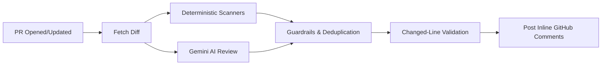

# 🛡️ GitHub PR-Review Agent with Guardrails

[](https://www.python.org/)
[](LICENSE)
[](#key-guardrails)

A security-first AI code review agent for GitHub Pull Requests. It pairs **deterministic security scanning** (credentials, tokens, risky Terraform) with **Google Gemini AI analysis**, protected by strict **schema validation, line-boundary constraints, comment limiting, and prompt-injection defenses**.

---

## ⚡ Key Features

- **Deterministic Secret Scanner**: Detects AWS keys, GitHub/Slack tokens, private keys, and high-entropy passwords before calling any AI models.
- **Terraform Risk Analyzer**: Catches dangerous IaC misconfigurations (`0.0.0.0/0` ingress, public S3 buckets, disabled encryption).
- **Dependency & Supply Chain Scanner**: Scans `requirements.txt`, `package.json`, and manifests for known CVEs (e.g., vulnerable requests, urllib3, lodash) and unpinned/wildcard dependencies.
- **One-Click GitHub Suggested Changes**: Generates native GitHub ```suggestion blocks for 1-click "Commit suggestion" fixes directly on PR lines.
- **PR Complexity & High-Level Summary**: Automatically calculates PR size categories (`XS`, `S`, `M`, `L`, `XL`), estimated human review effort, and affected domain breakdown.
- **Google Gemini Analysis**: Uses structured JSON output to analyze code logic, bugs, and edge cases.
- **Strict Guardrails**:
  - **No comments on unchanged lines**: Only comments on lines actually modified in the PR.
  - **Comment Limiting**: Caps inline comments (default: 5) to eliminate alert fatigue.
  - **Deduplication**: Automatically deduplicates overlapping AI and rule-based findings.
  - **Prompt Injection Defense**: Isolates untrusted PR diffs inside unforgeable delimiters.
  - **Stale PR Protection**: Aborts commenting if new commits were pushed during review.
  - **Least-Privilege Design**: Cannot merge, approve, or push code.

---

## 🔄 How It Works



---

## 🚀 Quick Start

### 1. Prerequisites
- Python 3.12+
- A Google Gemini API Key ([Get one free from Google AI Studio](https://aistudio.google.com/))
- A GitHub Personal Access Token (with `pull-requests:write` permission)

### 2. Installation
```bash
# Clone the repository
git clone https://github.com/bittush8789/pr-review-agent-guardrails.git
cd pr-review-agent-guardrails

# Install dependencies
pip install -r requirements.txt
```

### 3. Environment Setup
Copy the example environment file and fill in your keys:
```bash
cp .env.example .env
```

Key variables in `.env`:
```ini
GITHUB_TOKEN=ghp_your_github_token
GITHUB_REPOSITORY=owner/repo
PULL_REQUEST_NUMBER=1
GEMINI_API_KEY=your_gemini_api_key
GEMINI_MODEL=gemini-2.5-flash
MAX_COMMENTS_PER_PR=5
```

### 4. Run a Local Demo
Run the included demo script to test the review pipeline locally against sample vulnerable code:
```bash
python examples/run_demo.py
```

Or run the CLI directly against a live PR:
```bash
python -m app.main
```

---

## 🤖 GitHub Actions Setup

To automatically review every Pull Request in your repository, add [`.github/workflows/pr-review.yml`](.github/workflows/pr-review.yml):

1. Go to your repository on GitHub.
2. Navigate to **Settings > Secrets and variables > Actions**.
3. Add a repository secret named **`GEMINI_API_KEY`**.
4. That's it! Every new PR or commit will trigger an automated review.

---

## 🧪 Running Tests

The test suite contains full unit and integration tests with mocks (no live API keys required):

```bash
# Run all tests
pytest

# Run tests with coverage
pytest --cov=app
```

---

## 📁 Repository Structure

```text
├── .github/workflows/      # Automated PR review GitHub Actions workflow
├── app/
│   ├── config/             # Environment configuration & secret redaction
│   ├── github/             # GitHub REST API client & diff parser
│   ├── guardrails/         # Schema, line-boundary, and injection defenses
│   ├── providers/          # Google Gemini AI provider integration
│   ├── review/             # Review orchestrator & finding merger
│   ├── rules/              # Deterministic secret, Terraform, & dependency scanners
│   └── schemas/            # Pydantic/JSON schemas for findings & 1-click suggestions
├── evals/                  # Evaluation framework & benchmark datasets
├── examples/               # Standalone demo scripts (run_demo.py)
├── tests/                  # Unit and integration test suite
└── requirements.txt        # Python dependencies
```

---

## 📄 License

Licensed under the [Apache 2.0 License](LICENSE).
