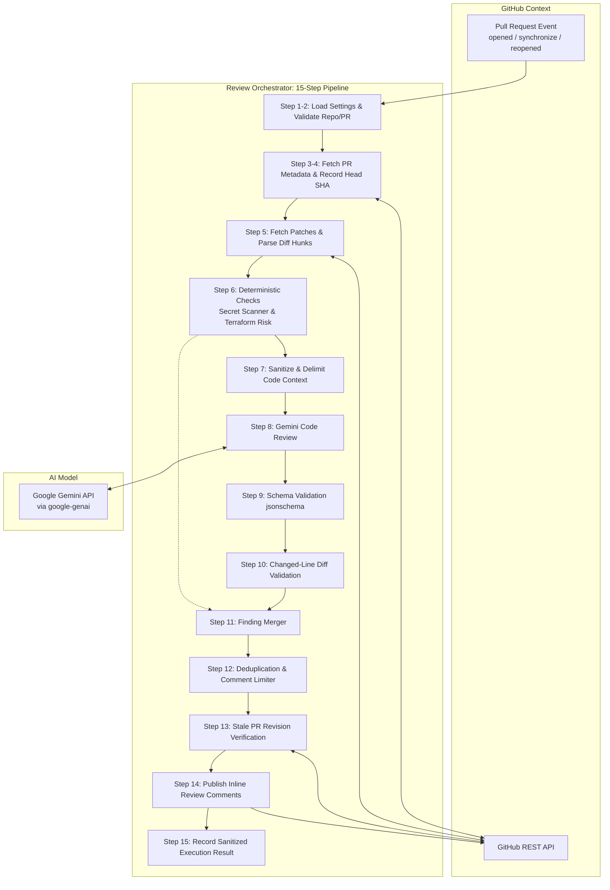

# Architecture Documentation

## 1. Overview and Design Objectives

The **GitHub PR-Review Agent with Guardrails** is a modular, security-focused review pipeline designed to act as an automated first-pass reviewer for GitHub Pull Requests. Its primary goals are:

1. **Protect Reviewer Time**: Automate discovery of routine bugs, missing tests, and configuration mistakes so human engineers can focus on architecture and business logic.
2. **Prevent Credential Leaks**: Detect hardcoded API tokens, private keys, and passwords deterministically before any code is shared with external services or merged.
3. **Guard Against Infrastructure Misconfigurations**: Flag risky Terraform changes such as unrestricted ingress (`0.0.0.0/0`) or public S3 buckets.
4. **Enforce Strict Guardrails**: Ensure that AI-generated comments never hallucinate non-existent files, comment on unchanged lines, spam the PR author, or expose confidential secrets.
5. **Mitigate Indirect Prompt Injection**: Treat all PR content (diffs, descriptions, comments) as untrusted user input, isolating it within boundary delimiters.

---

## 2. System Architecture Diagram

---

## 3. Order of Operations (15 Steps)

The orchestrator executes the review lifecycle in the following sequence:

1. **Load and Validate Configuration**: Load environment variables (`GITHUB_TOKEN`, `GEMINI_API_KEY`, `GEMINI_MODEL`, `MAX_COMMENTS_PER_PR`, `CONFIDENCE_THRESHOLD`) and validate bounds.
2. **Validate Repository and PR Identifier**: Ensure repository matches `owner/repo` format and PR number is a positive integer.
3. **Retrieve PR Metadata**: Fetch PR title, body, base branch, and current head SHA.
4. **Record PR Head SHA**: Pin the expected commit SHA at the exact start of analysis.
5. **Parse Diff and Map Eligible Changed Lines**: Parse unified diff hunks (`@@ -old,len +new,len @@`) into `valid_changed_lines`, identifying right-side line numbers where additions or modifications occurred.
6. **Execute Deterministic Checks**:
   - `SecretScanner`: Scan added line contents against regex patterns (AWS keys, GitHub tokens, private keys, passwords) and calculate entropy.
   - `TerraformRiskAnalyzer`: Scan `.tf` and `.tfvars` files for public ingress (`0.0.0.0/0`), public S3 buckets, disabled encryption, and wildcard IAM policies.
7. **Prepare Redacted, Minimal Code Context**: Run redaction filters on the diff to mask any detected credentials before packaging the context. Enclose untrusted diff text within unforgeable boundary delimiters.
8. **Request Gemini Findings**: Send system instructions and delimited diff payload to Google Gemini via `google-genai` using structured JSON output.
9. **Validate Response Against Schema**: Pass model output to `jsonschema` using `REVIEW_FINDINGS_JSON_SCHEMA`. Reject malformed JSON, missing fields, or invalid enum values.
10. **Validate File Paths and Changed Lines**: Verify that each AI finding targets a file in the PR and a line number within the verified `valid_changed_lines` set.
11. **Merge Deterministic and AI Findings**: Combine findings while preserving source tracking and rule IDs.
12. **Remove Duplicates and Apply Comment Limits**: Deduplicate overlapping findings targeting the same or adjacent lines. Enforce a strict upper bound (default: 5 comments) sorted by severity (critical > high > medium > low), source (deterministic > AI), and confidence score.
13. **Recheck Current PR Revision**: Query GitHub for the current PR head SHA. If a new commit was pushed while analysis was running, abort publication immediately to prevent posting comments on stale code.
14. **Publish Inline Review Comments**: Format findings as Markdown badges and post inline comments to `/repos/{owner}/{repo}/pulls/{number}/comments`.
15. **Record Sanitized Execution Results**: Emit an execution summary JSON object to standard output for workflow logging.

---

## 4. Key Subsystems

### 4.1 Diff Parser (`app/github/diff_parser.py`)
GitHub's inline review comment API requires attaching comments to specific lines on the right side of the diff. The `DiffParser` breaks unified diffs into structured hunks and maps every addition (`+`) to its right-side line number, while tracking context lines (` `) and deletions (`-`). Only lines in `valid_changed_lines` are eligible for inline comments.

### 4.2 Guardrails Pipeline (`app/guardrails/`)
- **Schema Validator**: Enforces strict typing, required fields, and path safety (rejects `..` or absolute paths).
- **Diff Line Validator**: Prevents the model from commenting on unchanged or deleted lines.
- **Duplicate Filter**: Consolidates overlapping feedback into a single actionable comment.
- **Comment Limiter**: Enforces the 5-comment ceiling to maintain high signal-to-noise ratio.
- **Injection Defense**: Delimits untrusted diffs and neutralizes potential markdown/HTML script injection.

### 4.3 Stale PR Protection (`app/github/review_publisher.py`)
In active repositories, authors frequently push additional commits while automated checks run. Posting comments based on an earlier commit creates confusion. The `ReviewPublisher` queries the GitHub API immediately before posting:
$$\text{current\_sha} \stackrel{?}{=} \text{expected\_head\_sha}$$
If the hashes differ, it raises `StalePullRequestError` and safely exits without publishing.

### 4.4 Fault Tolerance & Partial Failure Handling
If the Gemini API encounters rate limits, timeouts, or service unavailability:
- The orchestrator catches the exception gracefully.
- AI review is skipped without failing the pipeline.
- High-confidence deterministic findings (secrets, infrastructure risks) are still validated, deduplicated, and published.

### 4.5 Observability & LangSmith Tracing (`app/review/tracing.py`)
- Provides end-to-end tracing for orchestrator pipelines (`@traceable(name="pr_review_orchestrator", run_type="chain")`) and individual model invocations (`@traceable(name="gemini_generate_review", run_type="llm")`).
- Seamlessly exports prompt payloads, model responses, execution latencies, and token counts to the LangSmith platform when `LANGCHAIN_TRACING_V2=true` and `LANGCHAIN_API_KEY` are provided.
- Implements a transparent, zero-dependency fallback decorator when `langsmith` is absent, guaranteeing zero runtime impact on untraced workflows.
- Automatically redacts LangSmith API keys from application logs using `SensitiveDataFilter`.
